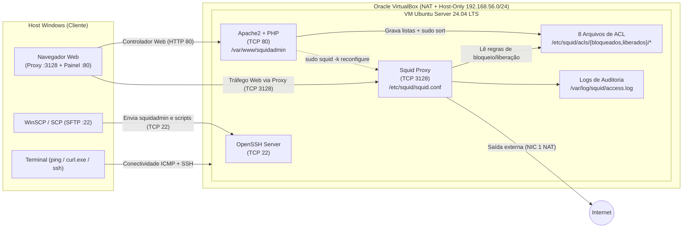

# Servidor Proxy Squid + Controlador Web (`squidadmin`) no Ubuntu (VirtualBox)

Guia completo, documentado e reproduzível de um projeto prático de **Redes de Computadores**: implantação de um **servidor proxy HTTP/HTTPS com Squid** no **Ubuntu Server (24.04 LTS)** dentro do **Oracle VirtualBox**, integrado a um **painel controlador Web em PHP (`squidadmin`)** servido pelo **Apache2**, com validação de ponta a ponta a partir de um host **Windows**.

> **Aviso de Privacidade e Uso Acadêmico:** todos os endereços IP (`192.168.56.x`, `192.168.1.x`), usuários (`usuario`, `aluno`), domínios de teste (`example.com`) e credenciais padrão exibidos nesta documentação são **exemplos privados/didáticos de laboratório (RFC 1918)**. Nenhuma informação pessoal, IP público, endereço MAC real ou credencial pessoal está armazenada neste repositório. Em ambientes de produção, altere as credenciais padrão do painel Web, utilize HTTPS e restrinja ainda mais o acesso administrativo.

---

## 1. O Que É Este Trabalho e O Que Ele Faz?

Em redes corporativas e acadêmicas, um **servidor proxy** atua como intermediário entre os computadores dos usuários e a internet. Este projeto implementa uma solução completa de controle de navegação em ambiente virtualizado:

- **Controle de acesso à internet (Squid Proxy — porta `3128`):**
  - Libera ou restringe a navegação da rede local por meio de **ACLs** (*Access Control Lists*) e regras `http_access`.
  - Suporta tanto tráfego **HTTP** quanto **HTTPS** (via túnel `CONNECT`).
  - Mantém registro auditável em tempo real de todas as requisições autorizadas e bloqueadas em `/var/log/squid/access.log`.
- **Administração dinâmica via navegador (Controlador Web `squidadmin` — porta `80`):**
  - Interface Web em **PHP** hospedada no **Apache2** (`http://<IP_DA_VM>/index.php`) protegida por tela de login.
  - Permite **bloquear** ou **liberar** (como exceção) **sites/domínios**, **palavras-chave na URL** e **endereços IP** diretamente pelo navegador.
  - Ao salvar qualquer lista no painel, o servidor ordena o arquivo de ACL e executa automaticamente `squid -k reconfigure`, aplicando a nova regra imediatamente sem derrubar o serviço.
- **Rede portátil e independente do Wi-Fi (VirtualBox `NAT` + `Host-Only`):**
  - Arquitetura com duas placas de rede virtuais para que a VM sempre tenha acesso à internet (via `NAT`) e mantenha uma rede local privada fixa com o host Windows (`192.168.56.0/24` via `Host-Only`), funcionando em casa, na faculdade ou em qualquer outra rede sem precisar reconfigurar IPs.

---

## 2. Arquitetura da Solução



---

## 3. Estrutura do Repositório

```text
.
├── README.md                                  # Visão geral do projeto, arquitetura e guia principal
├── setup-servidor.sh                          # Script idempotente para configurar tudo automaticamente no Ubuntu (inclui proxy.pac)
├── scripts/
│   ├── ativar-proxy.ps1 / ativar-proxy.bat    # Ativa o proxy do Windows (ou PAC) em 1 clique — Chrome, Edge e Firefox (normal e anônima)
│   └── desativar-proxy.ps1 / desativar-proxy.bat # Desativa o proxy do Windows em 1 clique ao encerrar a VM
├── docs/
│   ├── 01-virtualbox-e-ubuntu.md              # Criação da VM, rede NAT + Host-Only, IP fixo no DHCP e ping
│   ├── 02-instalacao-configuracao-squid.md    # Squid 6, estrutura /etc/squid/acls/, squid.conf, UFW, curl e logs
│   ├── 03-apache-winscp-controlador-web.md    # OpenSSH, WinSCP/SCP, Apache2 + PHP, squidadmin e sudoers
│   ├── 04-testes-cliente-e-troubleshooting.md # Proxy no navegador, guia anônima, roteiro de validação e troubleshooting
│   └── 05-comandos-rapidos.md                 # Folha de referência rápida (cheat sheet)
├── squidadmin/                                # Painel controlador Web em PHP (UTF-8 + normalização automática de URLs/HTTPS)
└── Squid-conf.odt                             # Arquivo legado de referência (Squid 2.7/3.x) analisado no Guia 02
```

---

## 4. Tudo Que Foi Feito e Descobertas Técnicas da Implementação

Durante a construção e validação real em **Ubuntu Server 24.04 LTS (Squid 6 + Apache 2.4 + PHP 8.3)** no **Oracle VirtualBox 7.2**, foram identificados e resolvidos os principais pontos críticos de integração entre os anexos originais e um sistema Linux moderno:

1. **Estrutura obrigatória dos 8 arquivos de ACL (`/etc/squid/acls/`):**
   - Os scripts PHP originais abriam `/etc/squid/acls/{bloqueados,liberados}/{ips,dominios,palavras,logins}` com `fopen(..., "r")` + `while(!feof($arquivo))`, causando loop infinito no PHP 8 caso algum arquivo não existisse. Além de criar os 8 arquivos com `www-data:proxy` (modo `644`), o helper [`squidadmin/normaliza_acl.php`](squidadmin/normaliza_acl.php) realiza leitura segura e evita travamentos.
2. **Normalização automática de URLs para bloqueio real em HTTPS (`CONNECT`):**
   - Em conexões **HTTPS**, o navegador envia `CONNECT www.youtube.com:443` ao Squid (sem `https://` e sem `/`). Se o administrador colasse `https://www.youtube.com/` diretamente na lista, a regra não casava.
   - O `normaliza_acl.php` extrai automaticamente apenas o domínio limpo (remove `http://`, `https://`, caminhos `/...`, portas, prefixo `www.`, duplicatas, linhas vazias e `\r`), convertendo `https://www.youtube.com/` em `youtube.com` — bloqueando `youtube.com`, `www.youtube.com` e `m.youtube.com` em **HTTP e HTTPS**.
3. **Permissão `sudoers` restrita para o usuário `www-data` + botão de Flush de conexões (`encerrar_conexoes.php`):**
   - Ao clicar em **Alterar**, o painel executa `sudo /usr/bin/sort <arquivo> -o <arquivo>` e `sudo /usr/sbin/squid -k reconfigure` (que aplica regras para novas conexões).
   - Como navegadores mantêm túneis HTTPS (`CONNECT`) já abertos e, por segurança, impedem que páginas web limpem seus sockets/cache internos via JavaScript, o painel também conta com a tela **[`encerrar_conexoes.php`](squidadmin/encerrar_conexoes.php)** (*Derrubar conexões / Flush*): um botão que executa `sudo /usr/bin/systemctl restart squid` (com `shutdown_lifetime 1 seconds` no `squid.conf`), derrubando em ~1 segundo todos os túneis TCP/HTTPS ativos no servidor, além de explicar didaticamente a diferença entre flush no servidor e cache local no Chrome (`chrome://net-internals/#sockets` + `Ctrl + Shift + R`).
   - Todas essas chamadas são restritas ao mínimo necessário em `/etc/sudoers.d/squidadmin` (validado com `visudo -cf`).
4. **Modernização das regras do `Squid-conf.odt` para Squid 6:**
   - O arquivo de referência [`Squid-conf.odt`](Squid-conf.odt) pertence a uma versão antiga (Squid 2.7/3.x) com diretivas removidas (`http_port 3128 transparent`, `extension_methods`, `acl manager proto cache_object`) e caminhos diferentes dos usados pelo `squidadmin`.
   - Preservamos o `/etc/squid/squid.conf` original do Ubuntu (com backup em `squid.conf.bak`) e inserimos um bloco limpo de ACLs na ordem correta de precedência (antes de `http_access deny all`):
     1. `allow ips_liberados` (acesso total, ignora bloqueios)
     2. `deny ips_bloqueados` (bloqueio total por IP)
     3. `allow minha_rede dominios_liberados` e `allow minha_rede palavras_liberadas` (exceções)
     4. `deny dominios_bloqueados` e `deny palavras_bloqueadas` (bloqueios ativos)
     5. `allow minha_rede` (restante da rede local)
     6. `deny all` (regra final padrão)
5. **Publicação do painel em UTF-8 + `proxy.pac` no Apache2:**
   - Os arquivos originais em ISO-8859-1 foram convertidos para **UTF-8** com `<meta charset="UTF-8">`, eliminando caracteres corrompidos (``).
   - O `setup-servidor.sh` também publica automaticamente `http://<IP_DA_VM>/proxy.pac` (*Proxy Auto-Configuration*, MIME `application/x-ns-proxy-autoconfig`), definindo `DIRECT` para o painel/localhost e `PROXY <IP_DA_VM>:3128` para o tráfego externo.
6. **Rede estável com IP fixo no VirtualBox + ativação do cliente em 1 clique:**
   - Combinando **Adaptador 1 (`NAT`)** + **Adaptador 2 (`Host-Only`)** + **reserva de IP fixo por MAC** no DHCP do VirtualBox (`VBoxManage dhcpserver modify`), a VM mantém sempre o mesmo IP local entre casa e faculdade.
   - Os scripts em [`scripts/`](scripts/) ativam/desativam o proxy do sistema Windows em 1 clique, aplicando automaticamente ao **Chrome, Edge e Firefox** (tanto em **guia normal** quanto em **guia anônima**).

### Por que NÃO usamos Proxy Transparente (`intercept`) nesta topologia?

| Abordagem | Precisa configurar o cliente? | Viável em Host Windows → VM VirtualBox? | Observações técnicas |
| :--- | :--- | :---: | :--- |
| **Proxy Explícito (`:3128`) + Scripts 1 clique** | Sim (automatizado em 1 clique via `scripts/ativar-proxy.bat`) | **Sim (recomendado)** | Funciona em HTTP e HTTPS (`CONNECT`), guia normal e anônima, sem alterar o roteamento do Windows. |
| **Script PAC (`http://<IP>/proxy.pac`)** | Mínima (1 URL ou `-UsePac` no script) | **Sim** | Padrão corporativo; define automaticamente o que vai `DIRECT` e o que passa pelo `PROXY`. |
| **Proxy Transparente (`intercept`)** | Não para HTTP (mas exige CA raiz no cliente para HTTPS/SSL-Bump) | **Não (com host Windows como cliente)** | Exige que o Linux seja o **gateway/roteador padrão** entre o cliente e a internet. Como o Windows é o host físico que fornece internet à VM via NAT, redirecionar o gateway do Windows para a VM criaria loop de roteamento. Só é possível adicionando uma **2ª VM cliente** em rede interna atrás da VM Ubuntu. |

---

## 5. Como Reproduzir o Projeto do Zero

### Pré-requisitos no Host Windows
- **Oracle VirtualBox** (7.x ou superior)
- **Imagem ISO do Ubuntu Server 24.04 LTS** ([releases.ubuntu.com/24.04](https://releases.ubuntu.com/24.04/))
- **WinSCP** (para transferência gráfica SFTP) ou cliente OpenSSH nativo do Windows (`ssh` / `scp`)
- Navegador Web (ex.: Mozilla Firefox, Google Chrome ou Microsoft Edge)

### Caminho 1 — Passo a passo didático (recomendado para estudo)
Siga os guias em sequência:

| Etapa | Guia | Descrição |
| :---: | :--- | :--- |
| 01 | [docs/01-virtualbox-e-ubuntu.md](docs/01-virtualbox-e-ubuntu.md) | Criação da VM no VirtualBox (GUI ou `VBoxManage`), rede `NAT + Host-Only`, reserva de IP fixo, instalação do Ubuntu e teste de `ping` |
| 02 | [docs/02-instalacao-configuracao-squid.md](docs/02-instalacao-configuracao-squid.md) | Instalação do Squid, backup, criação de `/etc/squid/acls/`, regras no `squid.conf`, validação (`squid -k parse`), UFW, `curl` e logs |
| 03 | [docs/03-apache-winscp-controlador-web.md](docs/03-apache-winscp-controlador-web.md) | OpenSSH, envio do `squidadmin` via WinSCP/`scp`, Apache2 + PHP, `DocumentRoot`, permissões `www-data:proxy` e `/etc/sudoers.d/squidadmin` |
| 04 | [docs/04-testes-cliente-e-troubleshooting.md](docs/04-testes-cliente-e-troubleshooting.md) | Configuração de proxy no navegador, roteiro completo de testes ao vivo e solução de problemas comuns |
| 05 | [docs/05-comandos-rapidos.md](docs/05-comandos-rapidos.md) | Folha de consulta rápida (*cheat sheet*) com todos os comandos, caminhos e portas |

### Caminho 2 — Provisionamento automatizado do servidor (após concluir o Guia 01)
Com a VM Ubuntu ligada, `ping` respondendo e OpenSSH ativo, você pode aplicar todos os passos dos **Guias 02 e 03** automaticamente com o script [`setup-servidor.sh`](setup-servidor.sh):

```powershell
# 1) Enviar a pasta squidadmin e o script para o Ubuntu (ou enviar via WinSCP)
scp -r squidadmin <SEU_USUARIO>@<IP_DA_VM>:~/
scp setup-servidor.sh <SEU_USUARIO>@<IP_DA_VM>:~/

# 2) Executar a configuração automática (ajustando a sub-rede se necessário)
ssh -t <SEU_USUARIO>@<IP_DA_VM> "sudo bash ~/setup-servidor.sh 192.168.56.0/24"
```

---

## 6. Validação Ponta a Ponta Realizada

O fluxo completo foi testado em ambiente real (Host Windows → VM Ubuntu Server 24.04 LTS) verificando:

| Camada Testada | Critério Validado | Status |
| :--- | :--- | :---: |
| **Rede (ICMP)** | `ping <IP_DA_VM>` a partir do Windows com `0%` de perda | OK |
| **Proxy HTTP (`:3128`)** | `curl.exe -I -x http://<IP_DA_VM>:3128 http://example.com` → `HTTP/1.1 200 OK` | OK |
| **Proxy HTTPS (`:3128`)** | `curl.exe -I -x http://<IP_DA_VM>:3128 https://example.com` → `200 Connection established` → `200 OK` | OK |
| **Controlador Web (`:80`)** | `http://<IP_DA_VM>/index.php` renderizado via Apache2 + PHP (`200 OK`) | OK |
| **Autenticação do Painel** | Login via `valida_login.php` iniciando sessão PHP e redirecionando para `inicio.php` | OK |
| **Bloqueio dinâmico ao vivo** | Inclusão de domínio em `bloquear_sites.php` → recarregamento automático (`sudo squid -k reconfigure`) → `HTTP/1.1 403 Forbidden` (`Squid`) | OK |
| **Desbloqueio dinâmico ao vivo** | Remoção do domínio no painel → retorno imediato para `HTTP/1.1 200 OK` | OK |
| **Portabilidade de IP** | Reserva fixa no DHCP Host-Only do VirtualBox mantendo sempre o mesmo IP da VM | OK |

---

## 7. Checklist Geral de Execução

- [ ] **Guia 01:** VM Ubuntu criada no VirtualBox com `NAT + Host-Only`, reserva de IP fixo e `ping <IP_DA_VM>` respondendo OK
- [ ] **Guia 02:** Squid ativo (`active (running)`), backup `squid.conf.bak`, 8 arquivos em `/etc/squid/acls/` e `squid -k parse` sem erros
- [ ] **Guia 03:** Apache2 + PHP + OpenSSH ativos, `squidadmin` publicado em `/var/www/squidadmin` e `/etc/sudoers.d/squidadmin` validado
- [ ] **Guia 03:** Painel Web abrindo em `http://<IP_DA_VM>/index.php` com login funcional
- [ ] **Guia 04:** Navegador configurado no proxy `<IP_DA_VM>:3128` (com exceção para `<IP_DA_VM>`)
- [ ] **Guia 04:** Bloqueios e liberações testados no painel e confirmados em `/var/log/squid/access.log`
