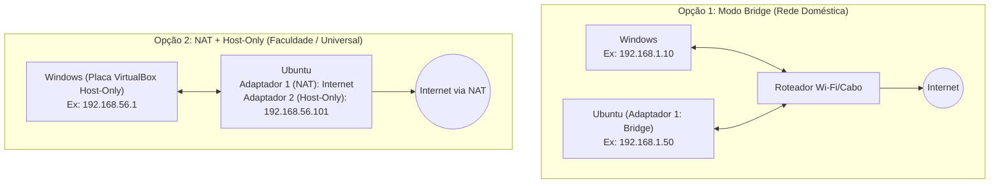

# Guia 01 — Oracle VirtualBox, Instalação do Ubuntu e Conectividade de Rede

Este guia cobre a criação da máquina virtual no **Oracle VirtualBox**, a instalação do **Ubuntu**, a configuração correta dos adaptadores de rede e o teste obrigatório de `ping` do **Windows** para o **Linux** (com acesso à internet funcionando na VM).

> **Navegação:** [Índice (README)](../README.md) | **Próximo:** [Guia 02 — Instalação e Configuração do Squid](02-instalacao-configuracao-squid.md)

---

## 1. Downloads e Preparativos

Antes de começar, tenha instalado/baixado no seu computador **Windows**:

1. **Oracle VirtualBox** (versão 7.x ou superior) + opcionalmente o *VirtualBox Extension Pack*.
2. **Imagem ISO do Ubuntu LTS** (ex.: `Ubuntu 24.04 LTS` ou `Ubuntu 22.04 LTS`):
   - **Ubuntu Server LTS (recomendado):** mais leve (usa pouca RAM e disco), já permite instalar o OpenSSH durante o assistente e reflete melhor um servidor real.
   - **Ubuntu Desktop LTS:** possui interface gráfica (útil se você preferir abrir terminal/navegador dentro da VM); precisará instalar o `openssh-server` manualmente no Guia 03.

---

## 2. Criando a Máquina Virtual no Oracle VirtualBox

1. Abra o **Oracle VirtualBox** e clique em **Novo** (*New*).
2. Preencha os dados básicos:
   - **Nome:** `Ubuntu-Squid` (ou outro nome de sua preferência)
   - **Imagem ISO:** selecione o arquivo `.iso` do Ubuntu baixado
   - **Tipo:** `Linux`
   - **Versão:** `Ubuntu (64-bit)`
   - **Importante (VirtualBox 7.x):** marque a opção **"Pular Instalação Desassistida"** (*Skip Unattended Installation*). Isso evita problemas de permissão `sudo` e teclado incorreto que às vezes ocorrem na instalação automática do VirtualBox.
3. Em **Hardware**, configure:
   - **Memória Base (RAM):** `2048 MB` (2 GB) para Ubuntu Server, ou `4096 MB` (4 GB) para Ubuntu Desktop.
   - **Processadores:** `2 CPUs`.
4. Em **Disco Rígido Virtual**:
   - Crie um novo disco virtual (**VDI**, alocado dinamicamente) com **20 GB a 25 GB**.
5. Clique em **Finalizar** — **ainda não inicie a VM**, vamos configurar a rede antes.

---

## 3. Configuração de Rede no VirtualBox

> **Por que não deixar apenas `NAT`?**  
> O modo `NAT` padrão do VirtualBox dá internet à VM, mas isola o Ubuntu em uma rede interna (`10.0.2.x`) inacessível diretamente pelo host Windows. Sem ajustar a rede, o `ping` do Windows para o Ubuntu e o acesso `http://<IP_DO_LINUX>/index.php` **não vão funcionar**.

Escolha **uma** das duas opções abaixo conforme o local onde você está fazendo o trabalho:



### Opção 1 — Placa em Modo Bridge (mais simples em casa)

Ideal quando você está na sua rede Wi-Fi/cabo doméstica. A VM aparece como mais um dispositivo na rede local.

1. Selecione a VM `Ubuntu-Squid` → clique em **Configurações** → **Rede**.
2. Na aba **Adaptador 1**:
   - Marque **Habilitar Placa de Rede**.
   - **Conectado a:** `Placa em modo Bridge` (*Bridged Adapter*).
   - **Nome:** selecione a placa de rede ativa do seu Windows (sua placa Wi-Fi ou Ethernet com cabo).
3. Clique em **OK**.

> **Atenção:** em redes de faculdade ou corporativas, a infraestrutura pode bloquear máquinas virtuais em modo Bridge (bloqueio de múltiplos endereços MAC). Se a VM não pegar IP ou não pingar, use a **Opção 2**.

---

### Opção 2 — NAT + Host-Only (mais confiável, funciona em qualquer rede)

Funciona em casa, na faculdade e até sem roteador externo para a comunicação Windows ↔ Ubuntu.

1. **Verifique a rede Host-Only no VirtualBox** (antes de abrir as configurações da VM):
   - No menu principal do VirtualBox, vá em **Arquivo → Ferramentas → Gerenciador de Redes** (*Network Manager*).
   - Na aba **Redes Somente-Hospedeiro** (*Host-Only Networks*), confira se existe `VirtualBox Host-Only Ethernet Adapter` (se não existir, clique em **Criar**).
   - Clique em **Propriedades**:
     - **Adaptador:** configurado manualmente, por exemplo IPv4 `192.168.56.1` e máscara `255.255.255.0`.
     - **Servidor DHCP:** deixe **Habilitado** (ex.: faixa `192.168.56.101` até `192.168.56.254`).
2. **Configure os 2 adaptadores na VM:**
   - Selecione a VM `Ubuntu-Squid` → **Configurações** → **Rede**.
   - **Adaptador 1:** habilitado, **Conectado a:** `NAT` *(fornece Internet para o Ubuntu)*.
   - **Adaptador 2:** habilitado, **Conectado a:** `Placa exclusiva de hospedeiro (Host-Only)` e selecione `VirtualBox Host-Only Ethernet Adapter` *(cria o canal direto Windows ↔ Ubuntu)*.
3. Clique em **OK**.

---

## 4. Instalação do Ubuntu

1. Clique em **Iniciar** na VM e selecione **Try or Install Ubuntu** (ou **Install Ubuntu Server**).
2. Siga o assistente:
   - **Idioma:** Português do Brasil (ou English, se preferir comandos/mensagens padrão).
   - **Teclado:** Português (Brasil) — ABNT2.
   - **Rede:** deixe em DHCP automático (na Opção 2, você verá duas interfaces, ex.: `enp0s3` e `enp0s8`).
   - **Disco:** *Use an entire disk* (padrão no disco virtual de 20–25 GB).
   - **Usuário e senha:** escolha um nome curto e sem espaços (ex.: `aluno`) e uma senha fácil de digitar durante os testes.
   - **Se for Ubuntu Server — Tela SSH Setup:** marque **`[X] Install OpenSSH server`**. Isso já deixa o SSH pronto para o WinSCP no Guia 03.
3. Aguarde a conclusão, clique em **Reboot Now** e pressione `Enter` caso apareça a mensagem para remover a mídia de instalação.
4. Faça login no Ubuntu com seu usuário e senha.

---

## 5. Descobrindo os Endereços IP

### 5.1. No Ubuntu (Linux)

Abra o terminal (no Desktop: `Ctrl + Alt + T`; no Server: já está no terminal) e execute:

```bash
ip -4 addr
```

**Como interpretar a saída:**
- `lo` (`127.0.0.1/8`): interface local (*loopback*). **Não** é o IP usado pelo Windows.
- `enp0s3` (1ª placa de rede):
  - Se usou **Opção 1 (Bridge):** mostrará o IP da sua rede local (ex.: `inet 192.168.1.50/24`). **Esse é o `<IP_DO_LINUX>`.**
  - Se usou **Opção 2 (NAT + Host-Only):** mostrará algo como `10.0.2.15/24` (essa é a saída NAT para a internet).
- `enp0s8` (2ª placa de rede — apenas na **Opção 2**):
  - Mostrará o IP da rede Host-Only (ex.: `inet 192.168.56.101/24`). **Esse é o `<IP_DO_LINUX>` que o Windows vai acessar.**

> **Atenção — E se `enp0s8` aparecer `DOWN` ou sem `inet` no Ubuntu Server?**  
> Às vezes, ao adicionar o 2º adaptador depois da instalação, o Netplan do Ubuntu Server só configura `enp0s3`. Para ativar `enp0s8` via DHCP:
>
> 1. Liste o arquivo de configuração do Netplan:
>    ```bash
>    ls /etc/netplan/
>    ```
> 2. Edite o arquivo `.yaml` encontrado (ex.: `50-cloud-init.yaml` ou `00-installer-config.yaml`):
>    ```bash
>    sudo nano /etc/netplan/50-cloud-init.yaml
>    ```
> 3. Adicione a segunda interface mantendo a indentação exata com espaços (sem TAB):
>    ```yaml
>    network:
>      version: 2
>      ethernets:
>        enp0s3:
>          dhcp4: true
>        enp0s8:
>          dhcp4: true
>    ```
> 4. Salve (`Ctrl + O`, `Enter`, `Ctrl + X`), aplique e verifique o IP novamente:
>    ```bash
>    sudo netplan apply
>    ip -4 addr
>    ```

### 5.2. No Windows (Host)

Abra o **Prompt de Comando** ou **PowerShell** e execute:

```powershell
ipconfig
```

- Na **Opção 1 (Bridge):** anote o IPv4 do seu adaptador Wi-Fi ou Ethernet (ex.: `192.168.1.10`) — deve estar na mesma faixa do Ubuntu (`192.168.1.x`).
- Na **Opção 2 (Host-Only):** localize `Adaptador Ethernet VirtualBox Host-Only Network` e confirme o IPv4 (ex.: `192.168.56.1`) na mesma faixa da `enp0s8` (`192.168.56.x`).

---

## 6. Testes de Conectividade (`ping`)

### Teste 1 — Ubuntu acessa a Internet? (no terminal do Ubuntu)

```bash
ping -c 4 8.8.8.8
ping -c 4 google.com
```

- **Esperado:** `4 packets transmitted, 4 received, 0% packet loss` em ambos os testes.
- O primeiro testa a conectividade IP externa; o segundo confirma que o DNS está resolvendo nomes.

### Teste 2 — Windows pinga o Ubuntu? (Passo obrigatório do trabalho)

No **PowerShell** ou **Prompt de Comando** do **Windows**, substitua `<IP_DO_LINUX>` pelo IP obtido no passo 5.1:

```powershell
ping <IP_DO_LINUX>
```

**Resultado esperado:**

```text
Disparando 192.168.56.101 com 32 bytes de dados:
Resposta de 192.168.56.101: bytes=32 tempo<1ms TTL=64
Resposta de 192.168.56.101: bytes=32 tempo<1ms TTL=64
Resposta de 192.168.56.101: bytes=32 tempo<1ms TTL=64
Resposta de 192.168.56.101: bytes=32 tempo<1ms TTL=64

Estatísticas do Ping para 192.168.56.101:
    Pacotes: Enviados = 4, Recebidos = 4, Perdidos = 0 (0% de perda)
```

> **Nota sobre `ping` no sentido inverso (Ubuntu → Windows):**  
> O Firewall do Windows Defender bloqueia respostas ICMP (`ping`) por padrão. Portanto, se o Ubuntu não conseguir pingar o Windows, isso é normal e **não impede** o trabalho — o requisito essencial é o **Windows pingar o Ubuntu com sucesso**.

---

## 7. Anote Seus Dados e Crie um Snapshot

### 7.1. Ficha do seu ambiente (use nos próximos guias)

Anote os valores reais da sua máquina antes de seguir:

| Parâmetro | Exemplo (Bridge) | Exemplo (Host-Only) | Seu valor real |
| :--- | :--- | :--- | :--- |
| **IP do Ubuntu (`<IP_DO_LINUX>`)** | `192.168.1.50` | `192.168.56.101` | `________________` |
| **Faixa / Sub-rede (para ACL do Squid)** | `192.168.1.0/24` | `192.168.56.0/24` | `________________` |
| **IP do Windows** | `192.168.1.10` | `192.168.56.1` | `________________` |
| **Usuário do Ubuntu** | `aluno` | `aluno` | `________________` |

> **Como descobrir a faixa CIDR da sua sub-rede:** se o IP mostrado no `ip -4 addr` for `192.168.56.101/24`, substitua o último octeto por `0` mantendo o `/24` → `192.168.56.0/24`.

### 7.2. Trave o IP Fixo no DHCP do VirtualBox (para nunca mudar entre casa e faculdade)

Usando a **Opção 2 (`NAT` + `Host-Only`)**, a rede `192.168.56.0/24` já não depende do Wi-Fi de casa nem da faculdade. Para garantir que o DHCP interno do VirtualBox entregue **sempre o mesmo IP** (ex.: `192.168.56.101`) em todos os reinícios, basta criar uma reserva fixa pelo endereço MAC da placa `NIC 2` no PowerShell do **Windows**:

```powershell
# 1) Descobrir o endereço MAC da NIC 2 (Host-Only) da sua VM:
& "C:\Program Files\Oracle\VirtualBox\VBoxManage.exe" showvminfo Ubuntu-Squid | Select-String "NIC 2"

# 2) Reservar sempre o mesmo IP para esse MAC (substitua <MAC_NIC_2> e o IP desejado):
& "C:\Program Files\Oracle\VirtualBox\VBoxManage.exe" dhcpserver modify `
  --network="HostInterfaceNetworking-VirtualBox Host-Only Ethernet Adapter" `
  --mac-address=<MAC_NIC_2> `
  --fixed-address=192.168.56.101

# 3) Confirmar que a reserva aparece em "Individual Config":
& "C:\Program Files\Oracle\VirtualBox\VBoxManage.exe" list dhcpservers
```

> **Dica de formato:** converta o MAC retornado pelo `showvminfo` (ex.: `080027AABBCC`) para o formato com dois-pontos (`08:00:27:aa:bb:cc`) ao passar em `--mac-address=`.

### 7.3. Crie um Snapshot no VirtualBox (boa prática)

Com o Ubuntu instalado e o `ping` funcionando:

1. No VirtualBox, clique no ícone de menu ao lado da VM `Ubuntu-Squid` → **Snapshots**.
2. Clique em **Tirar** (*Take*) e nomeie como **`01 - Ubuntu limpo + Rede OK`**.

Se alguma configuração do Squid ou Apache der errado mais adiante, você pode restaurar este ponto em segundos sem reinstalar o Ubuntu.

---

## 8. Solução de Problemas Rápida (Rede, Boot e `ping`)

| Sintoma | Causa provável | Como resolver |
| :--- | :--- | :--- |
| Primeiro boot parece travado em `Begin: Loading essential drivers ...` | No Windows com Hyper-V / Isolamento de Núcleo ativo, o VirtualBox roda em modo NEM (ícone de **tartaruga verde** na barra inferior), deixando o primeiro boot mais lento | Aguarde **2 a 4 minutos** antes de reiniciar — normalmente o sistema conclui o boot sozinho e chega em `login:`. |
| `Esgotado o tempo limite do pedido` no Windows | VM está somente em `NAT`, ou Bridge ligada à placa errada (ex.: Ethernet desconectada em vez do Wi-Fi) | Troque para **Bridge na placa ativa** ou use **Opção 2 (`NAT` + `Host-Only`)**. |
| `Host de destino inacessível` | Windows e Ubuntu estão em faixas de IP diferentes | Confirme com `ip -4 addr` e `ipconfig` se os 3 primeiros números do IP são iguais (ex.: `192.168.56.x`). |
| `enp0s8` aparece sem endereço `inet` | Interface Host-Only não configurada no Netplan ou DHCP da rede Host-Only desativado | Ative o DHCP no Gerenciador de Redes do VirtualBox e configure `enp0s8: dhcp4: true` no `/etc/netplan/` + `sudo netplan apply`. |
| `ping 8.8.8.8` funciona, mas `ping google.com` falha | Falha de DNS na VM | Verifique `/etc/resolv.conf` ou reinicie a rede (`sudo netplan apply` / `sudo systemctl restart systemd-resolved`). |
| Firewall do Ubuntu bloqueando conexões | UFW ativo bloqueando entrada | Confira com `sudo ufw status`; se estiver inativo, o bloqueio não é do UFW. |

---

## 9. Checklist de Saída do Guia 01

Antes de avançar para o **Guia 02 (Instalação e Configuração do Squid)**, confirme:

- [ ] VM `Ubuntu-Squid` criada e iniciando normalmente no Oracle VirtualBox
- [ ] `ping -c 4 google.com` funcionando dentro do Ubuntu (Internet + DNS OK)
- [ ] `ping <IP_DO_LINUX>` respondendo com `0% de perda` a partir do Windows
- [ ] IP do Ubuntu e faixa de sub-rede (`/24`) anotados
- [ ] Snapshot `01 - Ubuntu limpo + Rede OK` salvo no VirtualBox
